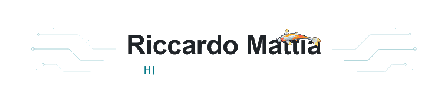

  <a href="https://github.com/R1CcKk">
    <picture>
      <source media="(prefers-color-scheme: dark)" srcset="assets/profile-dark.gif">
      <source media="(prefers-color-scheme: light)" srcset="assets/profile-light.gif">
      
    </picture>
  </a>

  &nbsp;
  &nbsp;
  

---
